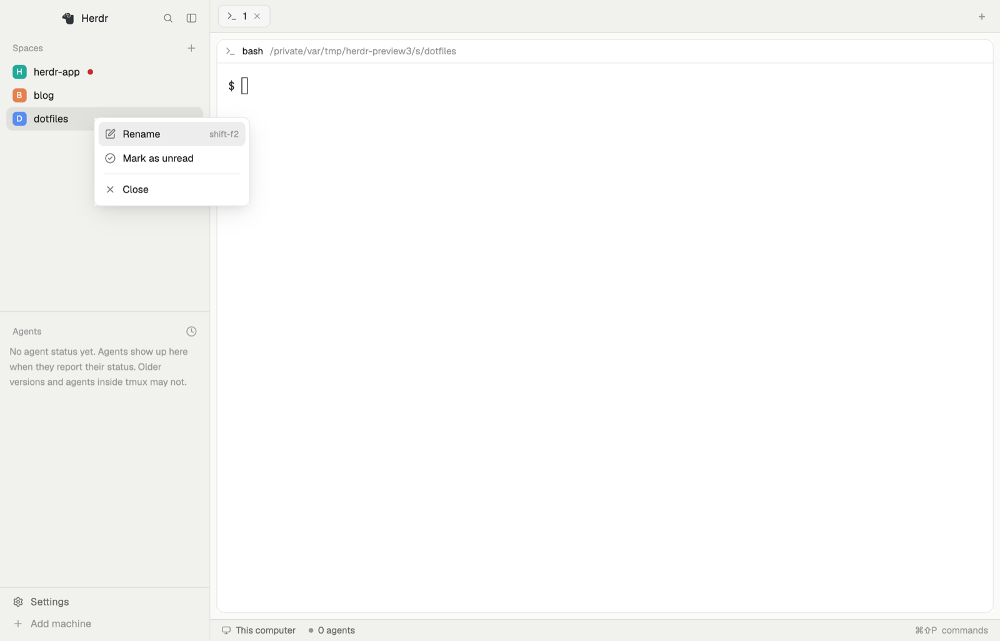

# herdr-spaces-unread

A [Herdr](https://herdr.dev) mod: the Spaces sidebar list with a manual
"unread" mark. Right-click a space, pick **Mark as unread**, and a red dot
stays after its name until you switch to it (or pick **Mark as read**).
Double-click to rename is included too.



## Install

Ask your agent to add both mods from this repo, or by hand:

```sh
cp -r mods/spaces-unread mods/spaces-unread-menu ~/.config/herdr-app/mods/
herdr-app do layout.clone '{"name":"main","as":"my-main"}'
```

Then in `~/.config/herdr-app/layouts/my-main.json` change the `spaces` block's
`"mod": "spaces"` to `"mod": "spaces-unread"`. The window follows within a
second. `ctrl-shift-l` switches layouts if you want Herdr's own back.

[RECIPE.md](RECIPE.md) is the brief an agent can rebuild it from.
