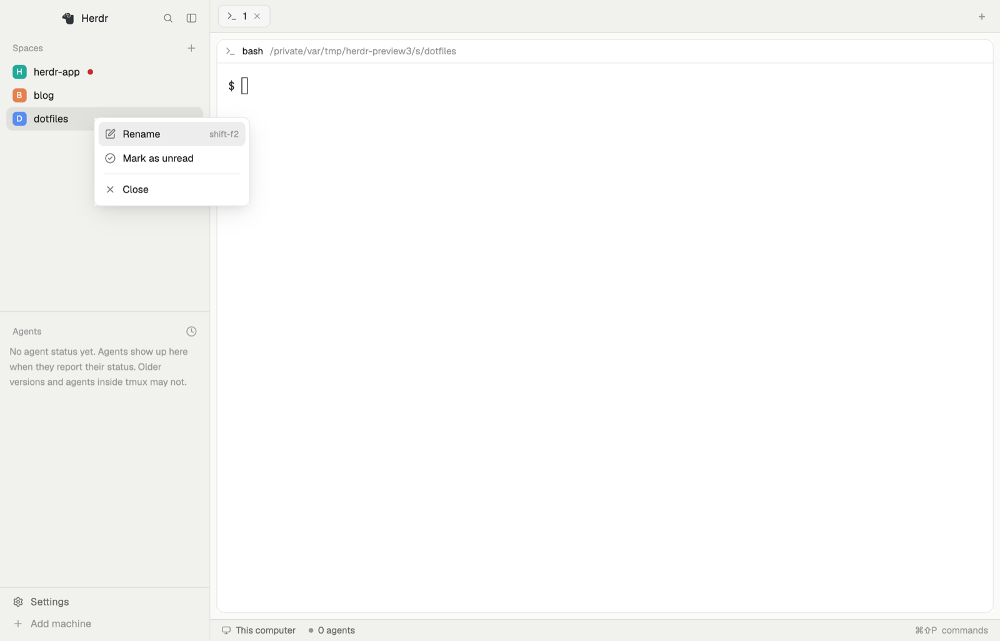

# Spaces (unread marks)

Herdr's own Spaces sidebar list, with a mark you set by hand: right-click a
space and choose "Mark as unread", and a red dot sits after its name until you
switch to that space. It is a reminder to yourself ("come back to this one"),
separate from agent status. Double-clicking a space renames it. Everything
else is the shipped `spaces` and `menu` mods as they are.

## What you see

- The sidebar list looks exactly like Herdr's Spaces list: a 31px "Spaces"
  header with a "+" button, one 30px row per space (28px for a worktree row)
  with an 18px colored avatar, the name, and dim git details at the right;
  machine headers once more than this computer is known.
- A marked space has a 7px round dot in the theme's `ansi1` (red) right after
  its name, 9px from it. In the collapsed rail (sidebar narrower than 160px)
  the dot is 6px and sits between the space's number and its status glyph.
- The space's right-click popup is 200px wide, rows 31px tall. Its items, top
  to bottom: Rename (with its key hint), **Mark as unread** or **Mark as
  read** (a circle-check icon), New worktree and Open worktree when the space
  is in a git repo, Remove worktree when it is a linked worktree, then a 1px
  divider and Close.

## How it behaves

- **Right-click** a row: opens the popup for that space. The second item
  reads "Mark as unread" when the space has no mark and "Mark as read" when
  it has one; choosing it toggles the mark and closes the popup. ↑/↓ move,
  Enter runs, Esc closes, as in Herdr's menus.
- **Switching to** a marked space clears its mark, however the switch
  happened (click, key, command, another mod). Marking the space you are
  already in does not clear at once: the mark goes the next time you come
  back to it.
- Marks are remembered across restarts. A closed space's mark is dropped the
  next time any mark is toggled.
- **Double-click** a row: opens the rename prompt for that space
  (`space.rename {id}` with no name, so the app asks).
- Click selects, drag reorders within a machine, as in the shipped list.
- Agent status is unrelated to the mark and is not shown in expanded rows.

## Built from

- `mods/spaces-unread/main.js`: a copy of Herdr 0.1.11's shipped
  `mods/spaces/main.js` (`cloned_from` in `mod.json`), plus:
  - `menu(w)` opens `spaces-unread-menu` in place of `menu`, same popup
    options and props (`{ tab: "space", target: { id } }`);
  - in `row()`, after the name:
    `.when(Boolean((shared("space.marks") ?? {})[w.id]), el => el.child(div().size(7).rounded(4).flex_none().bg(t.ansi1)))`,
    and the 6px equivalent in `compact()`;
  - at the top of `render()`, the active space's id is compared with the one
    from the previous render; when it changed (and this is not the first
    render) and the new one is marked, its entry is removed with `setShared`;
  - in `row()`'s left `on_mouse_down`:
    `if (e.click_count === 2) run("space.rename", { id: w.id });`
- `mods/spaces-unread-menu/main.js`: a copy of Herdr 0.1.14's shipped
  `mods/menu/main.js`, plus one item in the `"space"` case,
  `[marked ? "Mark as read" : "Mark as unread", "mark", { id }]`, and a
  `"mark"` branch in `choose()` that rewrites the shared map instead of
  running a command. `menuIcon` maps `"mark"` to `circle-check.svg`.
- Both `mod.json` files have `"place": "none"`: the list replaces the
  `spaces` block of a layout, the menu only opens as its popup.
- Shared storage: `space.marks`, an object `{ [space id]: true }`, read by
  the list and written by both. Also `space.colors` as in the shipped list.
- `herdr` functions: `spaces`, `machines`, `panes`, `terminals`, `keys`,
  `props`, `run`, `openOverlay`, `closeOverlay`, `exec`, `hc`, `theme`,
  `shared`, `setShared`, `watchFolder`, `window`, `layout`.
- Commands: `space.select`, `space.rename`, `space.move`, `space.new`,
  `space.close`; the `worktree` mod as a dialog.
- Shipped mods it uses: `workspace-chrome` for icons, `worktree`.
- Programs it runs: what the shipped mods run: `git status`, `git rev-parse`
  in each space's folder (on that space's machine), `hc machine ls --json`.

## Watch out

- Nothing shows until a layout points a block at `spaces-unread`. Clone the
  main layout (`layout.clone {"name":"main","as":"my-main"}`) and change the
  `spaces` block's `content.mod`; don't edit Herdr's `main.json`.
- The mark must live in `shared`, not `localStorage`: the popup and the list
  are different mod copies, and `setShared` is also what redraws the list.
- Clear the mark from `render()` by watching the active space, not from the
  row's click handler: spaces are also switched by keys and commands.
  Skip the first render, or every start would clear the mark of the space
  that happens to be open.
- Only the space popup is replaced. Tab and pane right-clicks still open the
  shipped `menu`, so the copy's other cases are unused.
- Copies of shipped mods go stale: the list is 0.1.11's `spaces`, the menu is
  0.1.14's `menu`. To refresh, re-clone the current shipped ones and re-apply
  the changes listed above.
- It reads no files outside its folder and reaches the network only as the
  shipped list does (git and `hc`, possibly over ssh on another machine).

## Done when

- `herdr-app check` passes for `mods/spaces-unread` and
  `mods/spaces-unread-menu`, and no `.error` file appears in the home.
- With a layout block set to `spaces-unread`, the sidebar looks like Herdr's
  Spaces list.
- Right-clicking a space shows "Mark as unread"; choosing it puts a red dot
  after that space's name, and the item then reads "Mark as read".
- Selecting the marked space from another one removes the dot; the dot
  survives restarting Herdr when the space was not visited.
- Double-click still renames, click selects, drag reorders.
